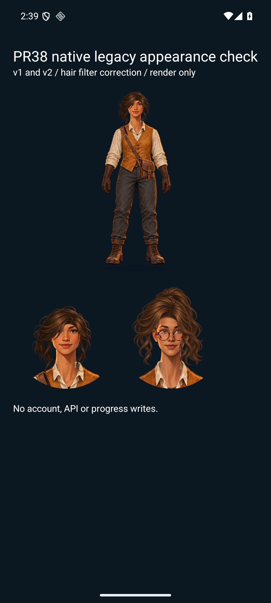

# Android avatar rendering verification — November 4, 2026

The native check found invisible filtered hair on Android. Its SVG renderer crops filter bitmaps in canvas pixels, whereas the original filter used the transformed atlas bounding box. Android now uses `userSpaceOnUse`; web and iOS retain `objectBoundingBox`. Filter regions include a small margin. Atlas region changes also replace the clip reference so native cached paths cannot retain the preceding style's crop.

## Tested source and environment

- Base: `c7fba18ff640cfac785ac3b0c3aa9d5eea52a343`, plus the correction in this commit. Final `avatar-figure.tsx` Git blob: `ccca31bd84153e4167cf0934d1b3735983c07ab3`.
- Android 16 / API 36, x86_64 emulator, React Native 0.88.0, Expo 58.0.19, react-native-svg 15.16.0.
- A separate development application imported the actual production component. Its APK SHA-256 was `BD1129D7B18A35E042C65BE10A4E9719E57C7964DCCF4D9ED676B312BD10174E`. Metro supplied the checked source; the APK hash identifies the native runtime, not its JavaScript revision.
- No sign-in, account/API connection or progress write. The existing Pocket Quests installation and data were preserved.

## Observed results

The direct base-component check rendered `v1:2:1:0:1:1` full body and portrait, and `v2:2:1:4:1:4:2:1` portrait. Hair, face, skin, clothes and glasses remained visible. The shared layer correction was also exercised by cycling Swept → Curls → Long → Cropped → Tied back in the layered-avatar fixture; the final atlas appeared without the previous crop.

The v1/v2 image predates only the clip-reference correction; filter settings and artwork are identical. The final clip-reference behavior is separately covered by the component regression and the native layered-avatar transition evidence in its owning PR.

Browser checks exercise actual SVG components separately. They preserve atlas-based filter coordinates; a browser-only pass is not native evidence.

## Remaining acceptance

iOS rendering, physical devices, VoiceOver/TalkBack, production provider sign-in and signed distribution were not run. This evidence covers the Android renderer and does not establish those results. Hosted CI, Sonar findings and native Codex review must still be inspected on the published head.
